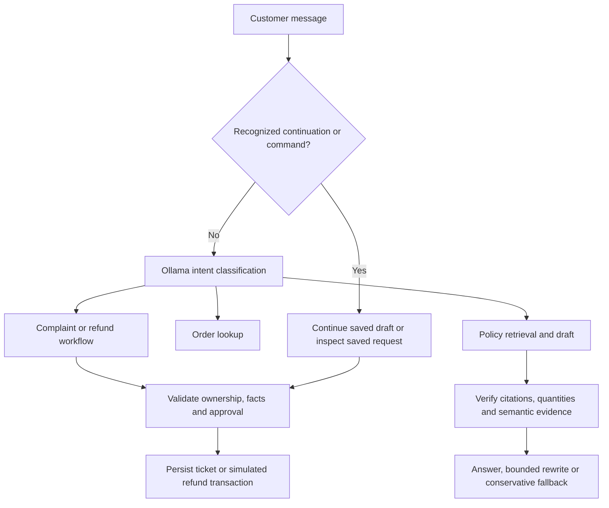

# SupportOps Agent

A local-model customer support demo that checks orders, answers policy questions,
creates complaint tickets, and manages simulated refunds with human approval.

Ollama classifies natural-language messages and generates policy answers. Python
controls the workflow, validates action arguments, checks write ownership, and
persists tickets and refund transactions in SQLite. This is a development demo:
refunds never transfer real money, and customer/admin identities are not authenticated.

## Current capabilities

- **Order inquiries:** status and dates from fictional orders, with previous-order
  context and explicit order switching in an interactive CLI.
- **Policy RAG:** Markdown chunks, BM25 plus normalized sentence embeddings, RRF,
  cross-encoder reranking, and source-cited answers.
- **Complaint tickets:** collect missing order IDs, validate ownership, persist
  tickets, cancel drafts, and retry the same request without duplicate tickets.
- **Refund workflow:** collect order/amount, require confirmation, evaluate verified
  sample facts, reserve balances, route amounts above USD 50 to human review, and
  record approved refunds in a simulation ledger exactly once per request.
- **Policy verification:** deterministic quantity/citation checks plus a separate
  model verification call, evidence quotes, and at most two answer rewrites.
- **Tracing and evaluation:** local JSONL traces and 28 isolated evaluation
  conversations with expected intents, tools, state, references, and database outcomes.

Latest validation passed **390 pytest tests** and **24/28 conversations** with
`qwen2.5:7b`. The smoke suite passed 10/10, the extended suite 9/10, and the
focused policy suite 5/8. See [evaluation results](docs/EVALUATION.md) for the
model and verification comparisons and the remaining failed cases.

Follow the [recording walkthrough](docs/DEMO.md) to demonstrate order follow-ups,
cited policy answers, complaint tickets, and an approval-gated simulated refund.

## Quick start

Requirements: Python 3.11+, Ollama, and enough memory for the selected models.
The first policy question loads embedding and reranking models and can be slow.

From the repository root in PowerShell:

```powershell
python -m venv .venv
.\.venv\Scripts\Activate.ps1
python -m pip install -e ".[dev]"
Copy-Item .env.example .env
ollama pull qwen2.5:7b
```

Start Ollama through its application, or run `ollama serve` in another terminal.
Use `Copy-Item` only when creating a new `.env`; preserve an existing configuration.
If using an existing Conda environment, activate it and install the editable project
with that environment's Python instead of creating another virtual environment.

```powershell
python -m supportops.cli
python -m supportops.cli "What is the status of order O1001?"
```

The default demo customer is C001. `--customer-id C002` selects a different fixture
identity; this is not a login mechanism. Type `exit` or `quit` to leave.

### Try the four workflows

Order inquiry and follow-up:

```text
What is the status of order O1001?
When was it ordered?
```

Policy question:

```text
Do returns require original packaging?
```

Complaint collection:

```text
My item arrived damaged. Please open a complaint ticket.
O1001
retry
```

Refund draft and confirmation:

```text
Refund O1001 USD 30.00.
confirm refund
refund status
retry refund
```

Refund eligibility depends on the sample delivery date and the current date.
O1001 was delivered on 2026-10-18; use the fixed-date standalone demo below for
repeatable refund examples after its return window has expired.

## Workflow design



The model does not freely loop over tools. Intent, conversation state, and Python
rules select the next operation. Bare IDs, amounts, confirmation, cancellation,
and explicit refund commands can bypass classification when the context is clear.
Policy questions preserve an unfinished complaint/refund draft. Pending drafts
are in memory; saved actions survive process restarts.

Read [DESIGN.md](DESIGN.md) for implementation boundaries and
[workflow examples](docs/WORKFLOWS.md) for all demo commands.

## Retrieval and verification

Policies live in `data/sample/policies/`. Each `## source.id` heading identifies
one chunk. BM25 and semantic search each supply up to five positive-scoring hits.
RRF retains five candidates; the reranker returns the top three for generation.

- Embeddings: `sentence-transformers/all-MiniLM-L6-v2`.
- Reranker: `BAAI/bge-reranker-v2-m3`, loaded on first use.
- RRF and reranker scores are ranking values, not probabilities.
- No arbitrary minimum semantic threshold is enabled by default.

```powershell
python -m scripts.try_search "original packaging" --local-files-only
python -m scripts.try_search "refund human approval" --top-k 3 --candidate-k 5
```

The verifier checks every draft sentence against cited sources and requires real
evidence quotes. Invalid answers are regenerated from the same sources, with a
maximum of three drafts total. Invalid rejection evidence gets at most one extra
judging call. The same Qwen model currently generates and verifies answers, so
false rejections and semantic mistakes remain known limitations.

Quantity checks distinguish policy numbers from supported applications to an
amount explicitly in the question. For example, USD 50.01 can be compared with
the documented USD 50 threshold. Omitted duration qualifiers can inherit one
unambiguous cited interpretation; explicit unit conflicts and changed range
bounds remain blocked. These checks never replace refund authorization code.

## Local data and tracing

Tickets, refund requests, and simulation transactions default to
`data/runtime/supportops.db`. Override locations for separate demos:

```powershell
python -m supportops.cli --customer-id C001 --ticket-db data/runtime/tickets-demo.db --refund-db data/runtime/refunds-demo.db --trace-file data/runtime/demo-traces.jsonl
python -m scripts.show_trace data/runtime/demo-traces.jsonl --last 5
```

Use `--details` with the inspector to see saved inputs/outputs, or `--no-trace`
with the CLI to disable tracing. Inspecting a trace never reruns an action.
Trace writes are best effort and do not retry business transactions on failure.
Known secret-named fields are redacted; customer text is not fully PII-redacted.
Keep runtime files private and out of Git.

## Tests and real-model evaluation

Unit/integration tests use fake models and temporary databases:

```powershell
python -m pytest -q
python -m ruff check src scripts evals tests
```

Real-model evaluation uses the actual workflow, fixed fixture dates, independent
case databases, and shared retrieval models within a run:

```powershell
python -m evals.run --list
python -m evals.run --local-files-only
python -m evals.run --cases evals/cases/smoke.json --cases evals/cases/extended.json --cases evals/cases/verifier_questions.json --local-files-only
```

`--local-files-only` requires previously cached retrieval models; omit it to allow
their initial download. Use `--case ID` for targeted evaluation and `--model NAME`
for a model override. Each run writes a new `data/runtime/evals/<run-id>/results.json`,
per-case traces, and databases. A failed case returns exit code 1, not a runner crash.

See [evaluation methodology and baseline](docs/EVALUATION.md). Automated reference
patterns cover selected facts, not a complete hallucination or injection metric.

## Configuration and current limits

`.env.example` documents the available settings. Ollama is the only implemented
provider. Structured-output retries and policy rewrite limits are enforced.

Each `run_message()` starts a fresh budget shared by classification, policy generation,
verification, retries, and tools. Defaults are 10 actual LLM requests and 5 public tool
invocations. Every attempt counts, including failed requests. The next operation is
blocked before execution when its call limit is exhausted; saved action IDs remain
available and completed writes are not replayed.

Ollama generation caps are 256 tokens for classification, 768 for answers, and 1,536
for verifier output. `MAX_TOTAL_TOKENS=20000` is an advisory threshold for reported
input plus output tokens: it logs one warning per message, not a hard total cap.
Missing provider usage cannot be counted. `budget.message` trace spans record limits,
usage, warnings, and blocking reasons. Without tracing, enforcement still applies.
Tool counts cover public tool entry points, not internal SQLite/store operations.
Standalone tool scripts do not establish a message budget. `MAX_STEPS` is deprecated
and ignored; configure the separate limits in `.env.example`.

The following remain unfinished and are recorded in the project backlog:

- Read-only order lookup does not yet enforce customer ownership. Write paths
  check ownership, but this is not an authenticated multi-user application.
- Total token usage is advisory; there is no hard aggregate token or wall-clock budget.
- `REFUND_AUTO_APPROVE_LIMIT` is parsed but does not override the current hard-coded
  USD 50 approval rule. Changing the environment value alone has no effect.
- Draft state is not durable; use saved refund IDs after restarting.
- Administrator review is a trusted local command; `--reviewer` is an audit label.
- Policy generation/verification still fails several negative or conditional questions.
- Refund execution is a local simulation with no real payment provider.

These limitations are intentionally documented in this snapshot. The repository
is a portfolio/development project, not a production support or payment service.
